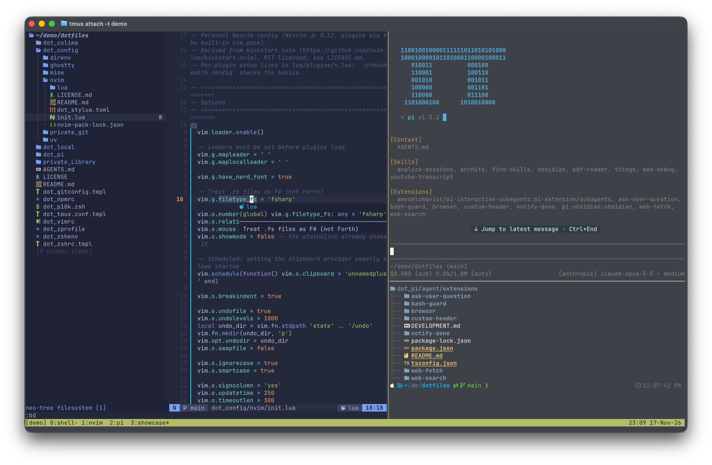

# dotfiles

My macOS and Debian setup, managed with [chezmoi](https://www.chezmoi.io). Built for running several coding agents in tmux at once.



## Highlights

- Get a notification when an agent finishes or needs you, and jump to its tmux pane ([notify-done](dot_pi/agent/extensions/notify-done/README.md))
- Confirm before an agent runs a destructive shell command (bash-guard)
- An [AGENTS.md](AGENTS.md) so coding agents can maintain the repo themselves
- Secret scanning on every commit and in CI
- One repo for macOS and Debian, with a lighter profile for servers

## Try it

Preview what would change, without applying anything:

```sh
chezmoi init GeorgopoulosGiannis/dotfiles && chezmoi diff
```

> [!WARNING]
> The macOS scripts change system settings, including replacing your Dock apps. Read `.chezmoiscripts/` before applying.

Full install steps for macOS and Debian are in [docs/install.md](docs/install.md). Or just copy the files you like; most stand alone.

## What's inside

| Area | Tools |
|------|-------|
| Shell | zsh, powerlevel10k, vi mode |
| Terminal | Ghostty, tmux |
| Editor | [Neovim 0.12](dot_config/nvim/README.md), plain vim on servers |
| Coding agent | [Pi](docs/pi.md) with extensions, skills and subagents |
| Runtimes | mise (Node, Go), uv (Python) |
| Secrets | passage, sops |
| macOS | Homebrew, system defaults, [Handy](https://github.com/cjpais/Handy) for dictation |

## Docs

- [Install](docs/install.md): macOS, Debian, servers, separate work settings
- [Pi coding agent](docs/pi.md): extensions, skills, setup
- [Day to day](docs/usage.md): common commands, tmux recovery, secrets
- [Design](docs/design.md): why these tools, and known limitations

Ideas and suggestions are welcome in [issues](../../issues).

## Credits

- [kickstart.nvim](https://github.com/nvim-lua/kickstart.nvim): the starting point of my Neovim config.
- [amosblomqvist/pi-config](https://github.com/amosblomqvist/pi-config): the starting point of my Pi config. `ask-user-question`, `bash-guard`, `browser`, `web-fetch` and all four skills come from it with small changes, and `custom-header` started from it (credited in each file). His [pi-interactive-subagents](https://github.com/amosblomqvist/pi-interactive-subagents), a fork of [HazAT's](https://github.com/HazAT/pi-interactive-subagents), provides the subagents.

## License

[MIT](LICENSE) for my own work. Files that come from other projects keep their original authors' terms: the Neovim config is derived from kickstart.nvim (MIT, see [`dot_config/nvim/LICENSE.md`](dot_config/nvim/LICENSE.md)), and the Pi files listed above come from amosblomqvist's repositories.
